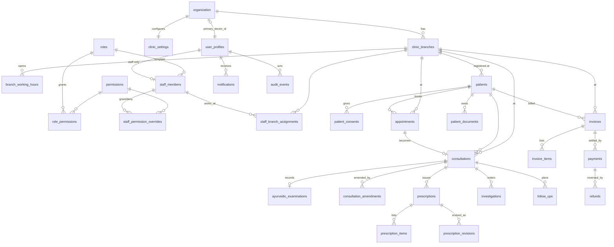

# Vaidyora — Architecture (revision 2: single organization)

Status: **implemented 03/11/2026** and applied to the hosted project. It replaces the multi-tenant clinic SaaS model of revision 1 (see [PHASE_A.md](PHASE_A.md) for that history).

Vaidyora serves one clinic organization, owned by **Dr. Ujjwal Karangale**, who is the only doctor. The organization has several branches and a staff that works across them. Nobody can register a clinic or a doctor.

## 1. What changes

| Revision 1 (multi-tenant SaaS) | Revision 2 (single organization) |
| --- | --- |
| Any user could create a clinic (`create_clinic`) and become its Admin + Doctor | No onboarding. One organization row is created by migration and can never be duplicated |
| `clinic_id` on every row; composite tenant keys; clinic picker | No tenant column. Isolation is by **branch** and **permission** |
| Several doctors; "doctor" was an assignable role | Exactly one primary doctor, bound once by a trusted bootstrap; no code path creates another |
| Fixed roles in an enum (`app_role`) | Account types (`primary_doctor`, `admin`, `staff`) plus configurable **role templates** and **per-staff overrides** |
| Subscription plans, plan limits, platform admins | Removed |
| Public sign-up page | Removed. Accounts exist only through staff invitation or the bootstrap |
| Admin could not read clinical notes | Admin **can view** consultations, examinations and prescriptions (as specified), but never write them |

## 2. Identities

```
auth.users ──1:1── user_profiles (account_type)
                     ├─ primary_doctor   exactly one; organization.primary_doctor_id points to it
                     ├─ admin            appointed by the primary doctor only
                     └─ staff ──1:1── staff_members (designation, role template, status)
```

- **Primary doctor:** `user_profiles.account_type = 'primary_doctor'` is protected by a unique partial index (at most one row). `organization.primary_doctor_id` is set once by `private.bind_primary_doctor()` (service role only), and after that a trigger refuses any change. Staff-management RPCs can't set or change `account_type`, and no RPC can deactivate the doctor.
- **Admin:** full administrative permissions on all branches, plus read-only clinical access. Only the primary doctor can appoint or remove an admin. An admin can't create admins or doctors.
- **Staff:** created only through `invite_staff` by an admin or the doctor. Effective permissions come from the role template plus overrides, and are limited to assigned branches.

## 3. Permission model

**Catalogue (`permissions`).** Each permission has:
- a key `module.action`;
- a module, an action (`view` · `create` · `edit` · `delete` · `finalize` · `export`) and a description;
- a `sensitivity`: `normal`, `sensitive` (needs a confirmation in the UI) or `clinical`;
- a `doctor_only` flag.

**Effective permissions of a staff member:**

```
(role_permissions[template] ∪ overrides.grant) − overrides.deny − doctor_only
```

They are evaluated in `private.effective_permissions(uid)` and branch-limited by `private.in_branch(uid, branch_id)`.

| Rule | Enforced by |
| --- | --- |
| `doctor_only` permissions (consultation write, examination write, prescription create/finalize, treatment plans) can't be placed in any template or override | Trigger on `role_permissions` and `staff_permission_overrides` |
| No self-elevation: nobody can change their own template, overrides or branches | `set_staff_permissions` RPC (`staff_id <> me`) |
| No escalation: a grantor can grant only permissions they hold themselves | Same RPC, checked against the grantor's effective set |
| Branch assignments are separate from permissions | `staff_branch_assignments` table, own RPC and own audit events |
| Inactive or invited staff have no permissions | Status check inside `effective_permissions` |
| Every change is audited with before/after permission keys (no PHI) | `audit_events` rows written by the RPCs |

**Default templates** (editable data, matching the brief's matrix): Receptionist, Clinic Coordinator, Accountant, Billing Executive, Assistant, Branch Manager, Custom (empty).

**Permission keys** (47; full matrix with defaults in [PERMISSIONS.md](PERMISSIONS.md), generated from the database):

| Module | Keys |
| --- | --- |
| patients | `view_basic`, `view_history`ᶜ, `create`, `edit_contact`, `edit`ˢ, `delete`ˢ (archive), `export`ˢ |
| consents | `manage` |
| appointments | `view`, `create`, `reschedule`, `cancel`, `update_status` |
| consultations | `view`ᶜ, `create`ᵈ, `edit`ᵈ |
| examinations | `view`ᶜ, `edit`ᵈ |
| prescriptions | `view`ᶜ, `create`ᵈ, `finalize`ᵈ, `print`ᶜ |
| investigations | `view`ᶜ, `order`ᵈ, `upload`ˢ, `manage`ˢ (status only, never results) |
| documents | `view`ᶜ, `delete`ˢ |
| follow_ups | `view`, `manage` |
| billing | `view`, `create`, `void`ˢ, `export`ˢ |
| payments | `record`, `refund`ˢ, `reconcile`ˢ |
| reports | `operational`, `financial`ˢ, `clinical`ᶜ |
| staff | `view`, `manage`ˢ, `permissions`ˢ |
| branches | `manage`ˢ |
| settings | `branch`ˢ, `organization`ˢ |
| audit | `view`ˢ |

ᶜ clinical (sensitive) · ᵈ doctor_only · ˢ sensitive

**Decisions taken during implementation**
- The doctor's own role has billing *view* and branch settings, but not organization settings or money handling (as the brief's matrix says). The doctor may still *grant* any non-doctor-only permission to staff, as owner; only staff with delegated `staff.permissions` are limited to what they hold.
- Medical background (allergies, chronic conditions, blood group, prakriti) lives in `patient_medical_profiles`, so a receptionist's patient view never contains it.
- Billing staff without `patients.view_basic` see the basic profile only of patients they bill at their branches.
- Notifications have no separate permission; the doctor is notified of bookings, cancellations and results.

## 4. Data model



**New or reshaped tables**

| Table | Key columns and constraints |
| --- | --- |
| `organization` | `id uuid pk`, `singleton boolean unique default true check (singleton)` (only one row is possible), `name`, `legal_name`, `primary_doctor_id → user_profiles unique` (write-once trigger), timestamps |
| `clinic_settings` | one row (`organization_id pk`): timezone, date format, locale, prescription footer, numbering prefixes |
| `clinic_branches` | `code unique`, name, address, phone, email, `is_active`, `is_primary` (one primary, partial unique index), `manager_staff_id` |
| `branch_working_hours` | `branch_id`, `weekday 1–7`, `opens_at`, `closes_at`, `slot_minutes`; no overlap (exclusion constraint) |
| `user_profiles` | `id → auth.users`, `account_type`, full name, phone, locale, `is_active`; partial unique index on `account_type = 'primary_doctor'` |
| `staff_members` | `user_id → user_profiles unique null` (null until the invite is accepted), name, mobile, email, `designation`, `role_id → roles`, employment fields (`employee_code`, `joined_on`, `employment_type`), `status` (`invited` · `active` · `inactive`), `created_by` |
| `roles` | `key unique`, name, description, `is_system` (system templates can't be deleted) |
| `permissions` | `key pk`, `module`, `action`, `sensitivity`, `doctor_only` |
| `role_permissions` | `(role_id, permission_key) pk`; trigger rejects `doctor_only` |
| `staff_permission_overrides` | `(staff_id, permission_key) pk`, `effect` (`grant` · `deny`), `granted_by`; trigger rejects a `doctor_only` grant |
| `staff_branch_assignments` | `(staff_id, branch_id) pk`, `assigned_by` |

**Kept, minus `clinic_id`:** patients (plus `registered_branch_id` and a unique `patient_code`), consents, appointments, consultations, amendments, examinations (plus `exam_field_definitions`), prescriptions, items, revisions, templates, investigations, patient_documents, invoices, items, payments, refunds, follow_ups, notifications, audit_events, counters.
- Every visit-level row carries `branch_id`.
- The doctor columns go, since the doctor is always the primary doctor; `recorded_by` (who did the work) stays.

**Removed:** `clinics`, `clinic_members`, `member_branches`, `platform_admins`, `subscription_plans`, `tenant_subscriptions`, `access_reviews`, `app_role`; the RPCs `create_clinic`, `platform_*` and plan-limit triggers; the clinic picker.

All tables have UUID keys, `created_at` / `updated_at`, and indexes for search: `pg_trgm` on patient name, plus phone, `patient_code`, `(branch_id, starts_at)` and `(branch_id, issued_at)`.

## 5. Authorization rules (RLS)

| Data | Who can read | Who can write |
| --- | --- | --- |
| Patient basic profile | `patients.view_basic`, organization-wide (needed to find returning patients and avoid duplicates) | `patients.create` / `edit_contact` / `edit` |
| Patient history and clinical records | Doctor; Admin; staff with the `clinical` view permission **and** a visit at one of their branches | Doctor only (`doctor_only`) |
| Appointments, invoices, payments, documents | Doctor and Admin: all branches. Staff: only rows whose `branch_id` is assigned to them | By the matching permission and branch |
| Staff, overrides, branches | `staff.view` / `branches.view` | Doctor, Admin, or staff with `staff.manage`, within their own permissions; never themselves |
| Audit events | Admin: all. Doctor: clinical events. Staff with `audit.view`: their branches | Nobody (append-only, written by triggers and RPCs) |

- **Helpers:** `private.me()`, `private.is_doctor()`, `private.is_admin()`, `private.can(perm)`, `private.can_at(perm, branch_id)`, `private.can_see_patient_clinical(patient_id)`.
- **Front end:** `my_access()` returns the same evaluation. The helpers `canViewPatients()`, `canCreatePrescription()` and so on are thin wrappers over it, used only to shape the UI. Changing a URL or an API call reaches RLS, which refuses.

**Duplicate patients:** `find_possible_duplicates(name, phone, dob)` uses phone equality plus trigram name similarity and DOB. Registration shows the matches and requires "Register as new patient anyway" or "Open existing". Nothing merges automatically; merge tooling comes later and needs review.

## 6. Front end

- **Access context:** `AccessProvider` (replaces the clinic context) provides `account`, `can(perm)`, `canAt(perm, branchId)`, `branches` and `activeBranch`, with an "All branches" option for the doctor, admin and multi-branch staff.
- **Navigation** is built from one route table, filtered by permission:
  - **Admin:** Overview · Patients · Appointments · Consultations · Prescriptions · Investigations · Billing & Payments · Reports & Analytics · Branch Management · Staff Management · Roles & Permissions · Audit Logs · Clinic Settings.
  - **Doctor:** Doctor Dashboard · Today's Appointments · Patients · Consultations · Ayurvedic Examinations · Prescriptions · Investigations · Follow-ups · Clinical Reports · My Profile. Branch Management and Staff Management sit under an "Administration" group.
  - **Staff:** only the modules their effective permissions allow.
- **Route guards:** `<RequirePermission perm="…">` on every route, so a direct URL shows "Not permitted".
- **New screens:**
  - **Staff list.**
  - **Add Staff wizard:** details → branches → template → permission review → invite.
  - **Staff detail:** profile, branches, permissions editor, activity, deactivate or revoke.
  - **Roles & Permissions** template editor.
  - **Branch list and detail:** contact details, working hours, staff, activate or deactivate.
  - **Doctor dashboard and Admin dashboard,** with a branch filter.
- **Permission editor:** grouped by module, one row per action, with a switch and an "inherited from template / overridden" marker. Sensitive and clinical switches open a confirmation dialog that names the effect. Changes are saved as one RPC call and audited.

## 7. Implementation

| Increment | Where | Status |
| --- | --- | --- |
| Database baseline: organization, identities, RBAC, evaluation, guards | `supabase/migrations/20261103000100`, `…0200` | ✅ |
| Clinical and billing schema on branches, RLS on the new helpers | `…0300`, `…0400` | ✅ |
| Dashboards, reports, notifications, storage, retention | `…0500` | ✅ |
| Trusted functions: `staff-admin` (invites, access, administrators), `document-url`, `npm run bootstrap` | `supabase/functions`, `scripts/bootstrap.ts` | ✅ code · ⏳ deploy |
| Front-end access layer, guards, permission-filtered navigation | `src/features/access`, `src/app/navigation.ts`, `src/app/router.tsx` | ✅ |
| Staff Management, Add Staff wizard, permission editor, Roles & Permissions | `src/features/staff` | ✅ |
| Branch Management with working hours | `src/features/branches` | ✅ |
| Admin, Doctor and staff dashboards; duplicate detection at registration | `src/features/dashboard`, `src/features/patients` | ✅ |
| Tests | `tests/db/access.test.ts`, `clinical-access.test.ts`, `workflows.test.ts`; unit and E2E suites | ✅ |

The old multi-tenant migrations (0001–0015) were replaced by this baseline before any real data existed; the hosted database was reset to it on 03/11/2026.
