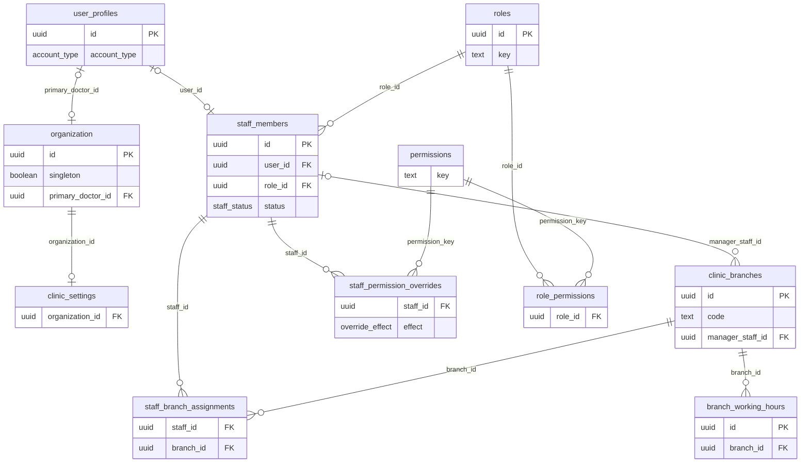
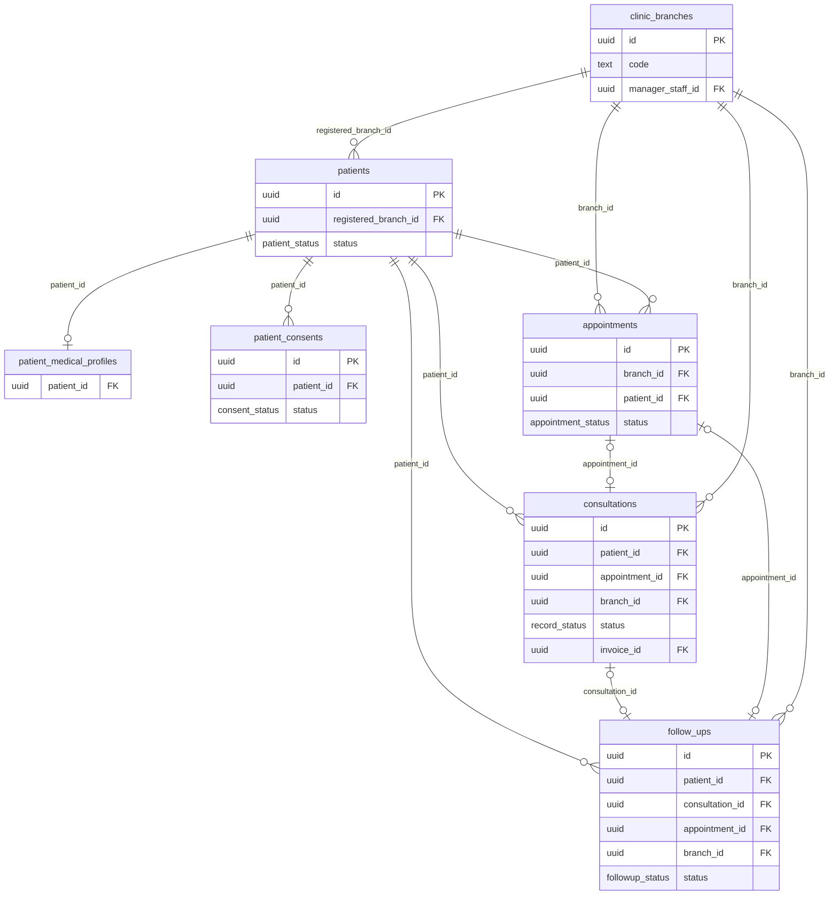
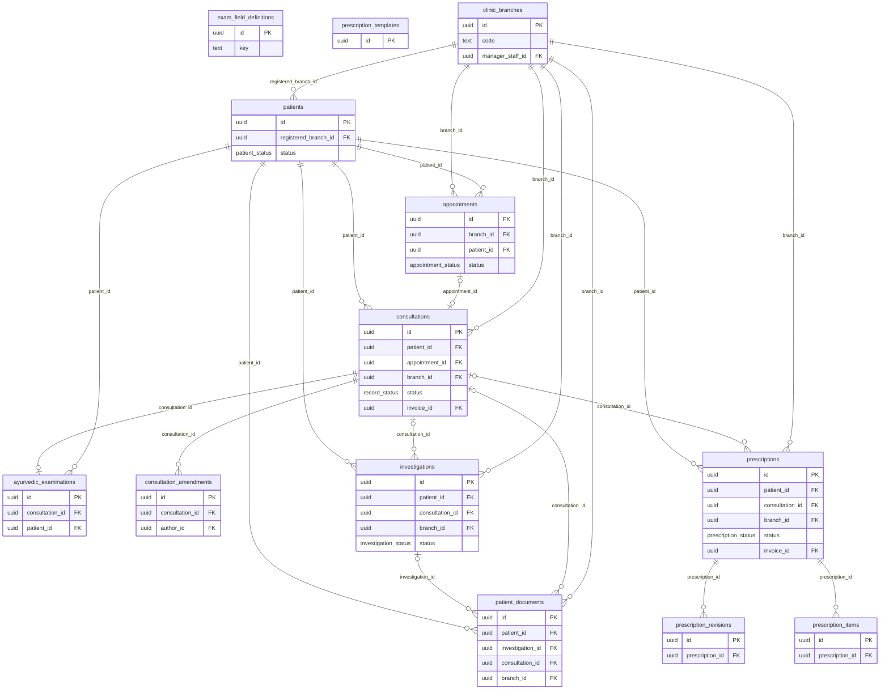
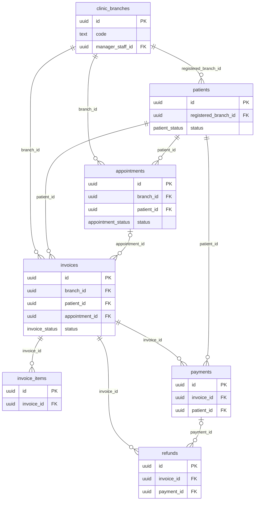
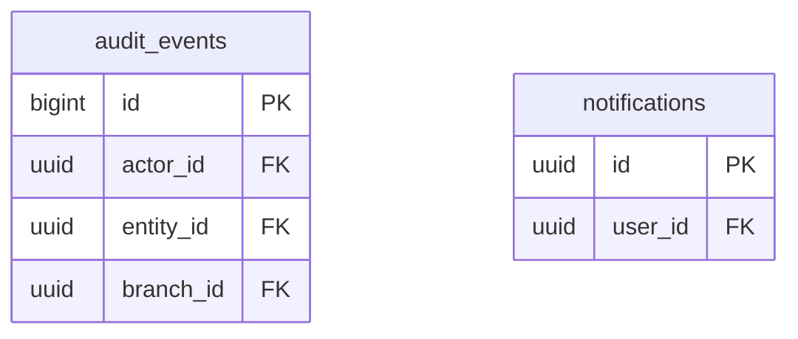

# Vaidyora — Entity relationship diagrams

> Generated by `npm run docs:db` from the migrations. Vaidyora holds one organization; tables have no tenant column. Visit-level rows carry `branch_id`.

32 tables. Field-level detail: [DATABASE.md](DATABASE.md).

## Organization, identity and access

## Patients and scheduling

## Clinical records

## Billing

## Audit and notifications

_audit_events.entity_id and branch_id refer to rows of any table (polymorphic, no FK), so events outlive the rows they describe._
