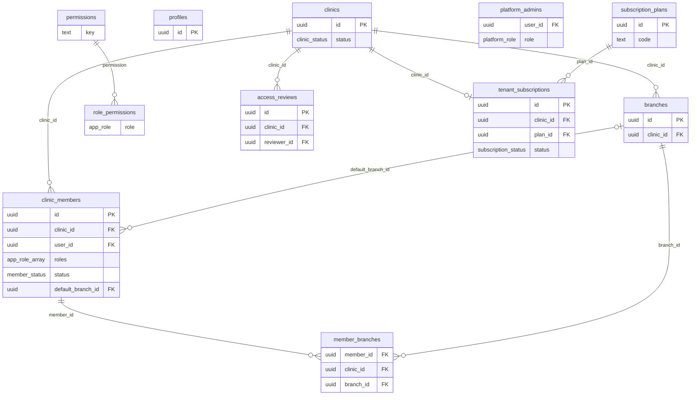
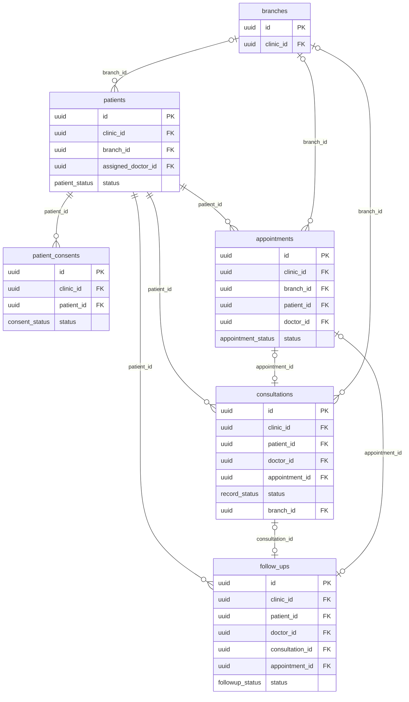
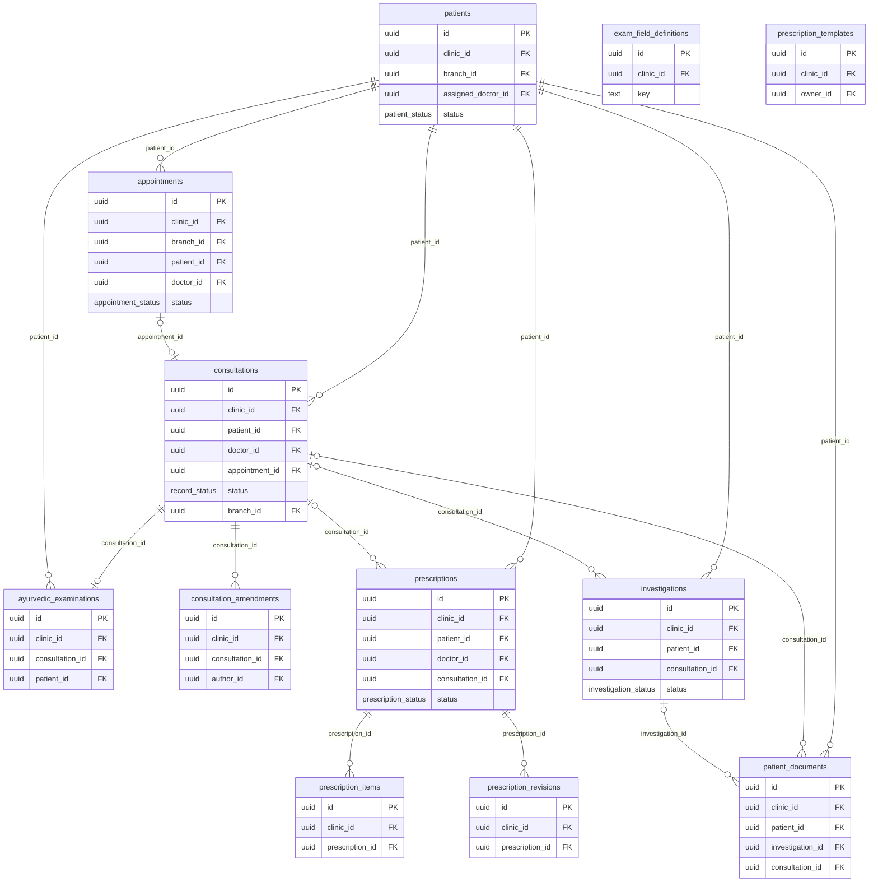
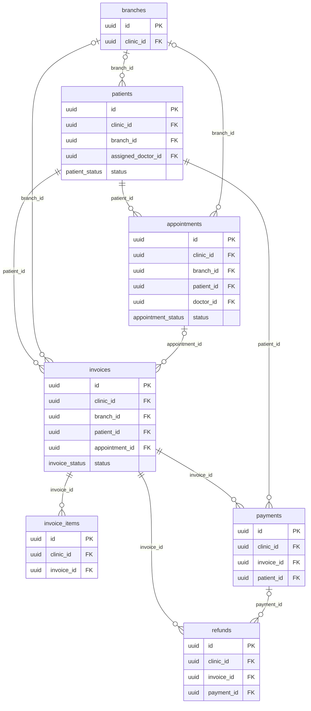
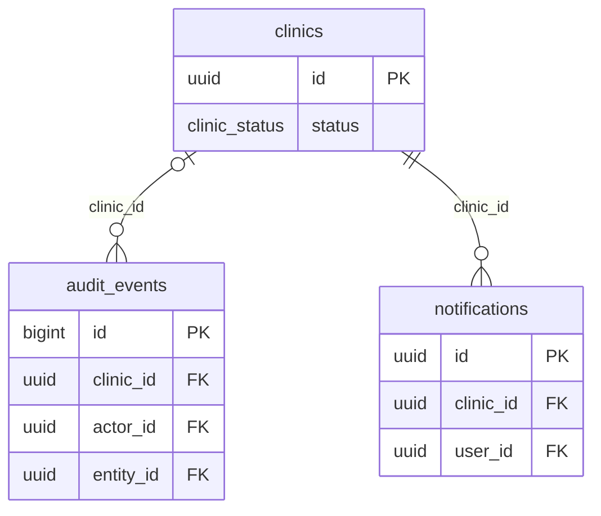

# Vaidyora — Entity relationship diagrams

> Generated by `npm run docs:db` from the migrations. Every tenant-owned table also has `clinic_id → clinics.id` (immutable) and composite foreign keys `(x_id, clinic_id)`; those clinic edges are drawn only in the first diagram.

31 tables. Field-level detail: [DATABASE.md](DATABASE.md).

## Tenancy, identity and access

## Patients and scheduling

## Clinical records

## Billing

## Audit and notifications

_audit_events.entity_id refers to the affected row of any table (polymorphic, no FK)._
